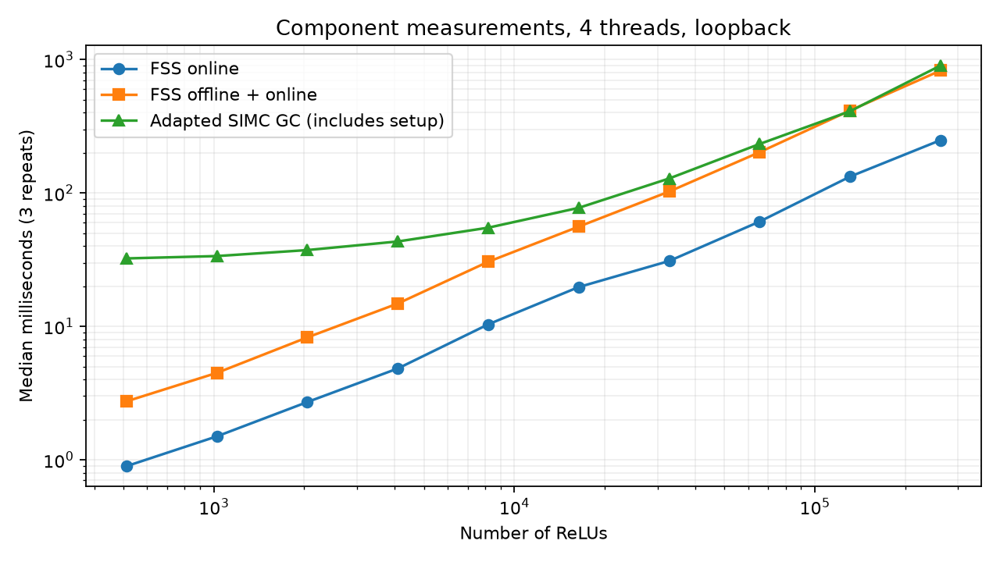
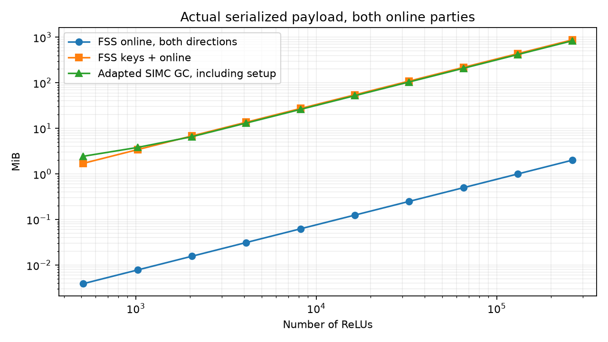

# CRISP 组件实验重测结果

## 环境

- 平台：macOS-14.6.1-arm64-arm-64bit；Apple M1 Pro；内存 16.0 GiB；SEAL 3.6.4，OpenSSL 3.6.0
- 两个独立在线进程 + 独立离线 dealer，127.0.0.1 TCP loopback, TCP_NODELAY; no bandwidth shaping
- 4 个工作线程，性能测试每组 3 次取中位数；模型训练不与性能测量重叠
- CKKS：N=8192/16384，模数链 [60,40,40,60]，scale=2^40，SEAL tc128，槽数 4096/8192
- 字节按 MiB=2^20 计；在线通信为双方发送量之和

## 输入维度

A：Conv(28×28,1→16,5×5,valid)，Pool2×2，Conv(12×12,16→16,5×5,valid)，Pool2×2，FC256→100→10；ReLU 总数 10340。

B：Conv(32×32,3→64,3×3,same)×2，Pool2×2，Conv(16×16,64→64,3×3,same)×2，Pool2×2，Conv(8×8,64→64,3×3,same)，Conv(8×8,64→64,1×1)，Conv(8×8,64→16,1×1)，FC1024→10；ReLU 总数 173056。

## ReLU

| ReLU数 | FSS离线ms | FSS在线ms | FSS离线keys MiB | FSS在线KiB | GC总ms | GC总MiB | 近似错数(3次) |
|---|---|---|---|---|---|---|---|
| 512 | 1.845 | 0.895 | 1.703 | 4.000 | 32.278 | 2.441 | 0 |
| 1024 | 2.982 | 1.498 | 3.406 | 8.000 | 33.616 | 3.816 | 0 |
| 2048 | 5.554 | 2.708 | 6.812 | 16.000 | 37.282 | 6.566 | 0 |
| 4096 | 9.989 | 4.831 | 13.625 | 32.000 | 43.245 | 13.082 | 0 |
| 8192 | 20.135 | 10.350 | 27.250 | 64.000 | 54.869 | 26.113 | 0 |
| 16384 | 36.176 | 19.695 | 54.500 | 128.000 | 77.266 | 52.177 | 0 |
| 32768 | 71.499 | 30.880 | 109.000 | 256.000 | 128.255 | 104.304 | 0 |
| 65536 | 140.915 | 60.973 | 218.000 | 512.000 | 232.609 | 208.558 | 0 |
| 131072 | 282.018 | 132.522 | 436.000 | 1024.000 | 409.518 | 417.065 | 0 |
| 262144 | 577.007 | 248.481 | 872.000 | 2048.000 | 900.170 | 834.081 | 0 |





每方每 ReLU 预处理密钥 1744 B（精确模式 3456 B），在线两方合计 8 B；精确模式在线通信不变。单个比较密钥 856 B = 16 B 种子 + 32×(16 B 种子校正 + 8 B 输出校正 + 2 B 控制位) + 8 B 最终校正。

| 批量ReLU数 | 离线批次s中位数 | 摊销离线μs/ReLU | 离线B/ReLU(两方) | 在线B/ReLU(两方) |
|---|---|---|---|---|
| 10340 | 0.023435 | 2.266 | 3488 | 8 |
| 173056 | 0.373392 | 2.158 | 3488 | 8 |

## 全连接

下表按每个 benchmark 包含的 FC 层求和（组件和，不含 setup）。

| Benchmark | N | FC在线组件和s | 在线MiB | 各层setup时间和s | 各层setup MiB和 |
|---|---|---|---|---|---|
| A | 8192 | 0.065760 | 2.810753 | 0.275487 | 26.276 |
| A | 16384 | 0.132963 | 5.518254 | 0.462566 | 44.101 |
| B | 8192 | 0.035794 | 1.405095 | 0.159530 | 15.121 |
| B | 16384 | 0.071154 | 2.758785 | 0.287041 | 27.343 |

## 网络组件

| 模型 | ReLU数 | FSS离线s | FSS keys MiB | Linear组件和s | Linear在线MiB | ReLU在线s | ReLU在线MiB |
|---|---|---|---|---|---|---|---|
| A | 10340 | 0.023435 | 34.395 | 2.675419 | 5.432 | 0.010794 | 0.078888 |
| B | 173056 | 0.373392 | 575.656 | 11.408550 | 43.258 | 0.164415 | 1.320312 |

## MaxPool（A 网络两层池化：10240 输入 / 2560 窗 / 7680 比较）

| 离线s中位数 | 离线key MiB | 在线ms中位数 | 在线双向KiB | 错误 |
|---|---|---|---|---|
| 0.027272 | 25.547 | 7.005 | 60.000 | 0 |

## 模型准确率

| 模型 | 完整测试数 | 明文准确率 | 定点模拟准确率 | HE/FSS样本数 | 样本预测与明文一致率 | 样本最大logit误差 |
|---|---|---|---|---|---|---|
| A | 10000 | 98.85% | 98.85% | 16 | 100.0% | 3.7875e-05 |
| B | 10000 | 76.84% | 76.83% | 16 | 100.0% | 0.000323562 |

## 复现

```sh
./build.sh
python3 run_suite.py
.venv/bin/python accuracy.py 16
.venv/bin/python make_report.py
```

数据/权重可由 `.venv/bin/python train_models.py` 重新生成；数据下载地址、校验和及模型来源在 DATA_MODEL_PROVENANCE.json，机器可读实验配置在 EXPERIMENTS.json。
